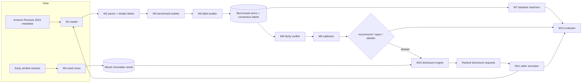

# Implementation Specification

*Stage 3 of [WORKFLOW.md](../WORKFLOW.md). Update whenever the design changes. Written 2026-10-21 to match [`project-spec.md`](project-spec.md); theory in [`theory.md`](theory.md). "Exists" points at code in `04-implementation/`; everything else is to build.*

## Modules

| ID | Module | Code | Status |
|---|---|---|---|
| M1 | Listing loader and renderer (visible text only; `details` hidden) | `rq1_pilot/data.py` | Exists (All_Beauty); add `META_JSONL` runs for Beauty_and_Personal_Care and Home_and_Kitchen |
| M2 | Attribute vocabulary, rule parser, `details` normaliser, support label | `rq1_pilot/attributes.py` | Exists for Beauty; Home & Kitchen vocabulary to add |
| M3 | G0 / category counter | `rq1_pilot/g0_count.py`, `category_check/category_check.py` | Exists |
| M4 | Need miner (checkable needs from early reviews, verbatim-quote checked) | `rq1_pilot/mine_needs.py` | Exists |
| M5 | Benchmark builder: edits, conjunctions, paraphrase, distractors, brand overlays, one-item-per-product pools | `rq1_pilot/edits.py`, `rq1_pilot/hard_split.py` | k = 1 and k = 2, paraphrase exist; distractor, brand mask, k = 3, choice-set protocol to add |
| M6 | Label auditor (independent quote judge; consensus labels) | `rq1_pilot/audit_labels.py`, `hard_split.judge` | Exists (Claude Opus judge); open-weight judge to add |
| M7 | Matchers: naive, strict, strict per constraint, extract-then-rule, keyword, dense (BLaIR, Qwen3-Embedding, BM25), confidence abstention, NLI verifier | `rq1_pilot/matchers.py` | LLM and keyword exist; dense code exists, not run; BM25, Qwen3-Embedding, confidence-abstention and NLI to add |
| M8 | NeSy verifier (+ quote-only NLI typed check) | `matchers.nesy_verifier` | Exists; NLI check to add |
| M9 | Calibrator: Algorithm 1 (fixed-sequence LTT on (λ, τ), one item per product), conjunctive min / max | `rq1_pilot/conformal.py`, `ltt.py` | Exists for k = 1; extend to k ≥ 2 and group-wise (Theorem 4) |
| M10 | Disclosure engine: gap attribution, demand ranking, request text | — | To build |
| M11 | Seller simulator: truthful, adversarial, GEO, impute-then-verify | — | To build |
| M12 | Evaluator and reporter (tables, bootstrap CIs, certifiability, yield, exposure gap) | `rq1_pilot/analyze.py`, `analyze_conformal.py`, `hard_split.analyze` | Exists for RQ1 and C2; C3 and exposure to add |

## System diagram

## System architecture

Three layers, all batch and file-based (JSONL in, JSONL / JSON / Markdown out), so every number reruns from caches:

1. **Data layer (M1–M4).** Streams the category files, keeps `details` out of anything a matcher sees, and produces the L2 pool and mined needs.
2. **Benchmark layer (M5–M6).** Turns real listings into labelled items. Every edit is re-labelled by the parser and audited by an independent judge; items whose labels disagree are kept but flagged, and the audited subset is reported separately.
3. **Decision and loop layer (M7–M12).** Matchers score items; the calibrator certifies (λ, τ) on product-disjoint splits; abstentions flow into the disclosure engine, whose requests the seller simulator answers; the edited listing re-enters M1, and the evaluator compares before and after at the same certified thresholds.

LLM calls go through one cached backend (`llm.py`: Claude via the Claude Code CLI, open-weight via Ollama). Dense encoders run on the Mac (Hugging Face is not reachable from the cloud).

## Modules: Input → Process → Output

| Module | Input | Process | Output |
|---|---|---|---|
| M1 | `meta_<Category>.jsonl` or the cohort CSV | Dedup by `parent_asin`; keep title, bullets, description, store, `details` | `Listing` objects; `render()` = what matchers see |
| M2 | Listing text, `details` | Controlled-vocabulary regexes; unit normalisation (Home & Kitchen); `details` → canonical values | Per-attribute values and spans; L2 label per (listing, constraint) |
| M3 | Listings, review file | Agreement counts per attribute; early-review rule proxy; sample-size calculator | `g0.json`, `category_check.json` |
| M4 | Early verified reviews | LLM extracts checkable needs with verbatim quotes; checks quote, vocabulary, second-model agreement | `mined_needs.json` |
| M5 | Listings with agreed attributes; edit spec (k, evidence form, overlay) | Minimal real edits; paraphrase by LLM with banned surface forms; distractor insertion; conjunction assembly; drop any item whose parser label isn't the intended one | `items.jsonl` per pool (`calpool.jsonl` one item per product; `hard/items.jsonl`) |
| M6 | Items | Independent judge must quote verbatim; consensus label = parser and judge agree | Audit JSON; `judge_agree` flag per item |
| M7 | Items (rendered listing + need text) | Batched prompts with opaque ids, or similarity scores | `preds/<matcher>__<model>.json`: decision + score |
| M8 | Items, per constraint | LLM proposes support / contradiction quotes and confidences; certificate checks grounded + typed (+ NLI on the quote); tiered score | e, c per constraint; e = min, c = max over a need |
| M9 | e, c, consensus labels, α, α′, δ | Product split; tune split fixes τ and the λ path start; fixed-sequence binomial tests; deploy the certified θ with the highest coverage, or abstain on everything | Certified (λ, τ) or none; test URR, URJ, coverage with CIs |
| M10 | Abstained items with per-constraint e; mined needs per subcategory | Attribute(s) with e < λ; count of mined needs that the fix would unlock; template a verification question | Ranked requests: (listing, attribute, demand count, question) |
| M11 | Requests; `details` (truth) | Truthful: add one sentence stating the `details` value. Adversarial: state a value `details` contradicts. GEO: E-GEO rewrite prompt. Impute: LLM guesses the value | Edited listings, tagged by seller type |
| M12 | Predictions, labels, certified thresholds, before / after listings | Recommend rates by cell; URR / coverage / recall; certifiability; disclosure yield; entrant exposure gap; GEO faithfulness; product-cluster bootstrap | `results.{json,md}` per experiment; entries in `05-report/report.md` |

## Data flow between modules

1. M1 → M2 → M5: listings become labelled benchmark items; `details` leaves this path as labels only.
2. M5 → M6: every item is audited; the audited subset and the full set are both carried forward.
3. M6 → M7, M8: matchers see `render()` and the need text only (a unit test checks that no id, label, variant or attribute key reaches a prompt).
4. M8 → M9: calibration uses consensus labels on one item per product; thresholds are fixed before test products are touched.
5. M9 → M10 → M11 → M1: abstentions become requests; simulated sellers edit listings; edited listings re-enter the pipeline and are scored with the **same** certified thresholds, so yield is measured at fixed risk.
6. M4 → M10: mined needs weight requests by demand; they never enter calibration.
7. Everything → M12 → `05-report/report.md`, with the run date.
