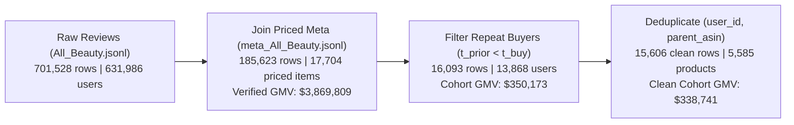

# Exploratory Data Analysis (EDA): Evidence-Based Launch Matching & GMV

## 1. EDA Charter

- **Decision / Research Goal:** Diagnose how AI recommenders trade off verifiable listing evidence against brand/popularity/persuasive priors (**RQ1**), evaluate whether a selective agent can match strictly on evidence and abstain when evidence is missing (**RQ2**), and test whether launch-time evidence matches predict post-launch customer satisfaction and retained GMV (**RQ3**).
- **Source Files & Grain:**
  - Raw Reviews: [All_Beauty.jsonl](file:///Users/cattleya.c/Downloads/All_Beauty.jsonl) (**701,528 rows**, 1 row per review event)
  - Raw Product Listings: [meta_All_Beauty.jsonl](file:///Users/cattleya.c/Downloads/meta_All_Beauty.jsonl) (**112,590 rows**, 1 row per `parent_asin`)
  - Clean Deduplicated Longitudinal Cohort: [hackathon_beauty_gmv_dedup.csv](file:///Users/cattleya.c/.gemini/antigravity/scratch/all_beauty/hackathon_beauty_gmv_dedup.csv) (**15,606 rows**, strictly 1 row per `(user_id, parent_asin)` where the customer has $\ge 1$ prior review at $t < t_{\text{buy}}$ and the item has a valid USD `price`).
- **Time Coverage:** `2005-02-02` to `2023-09-09` (18.6 years; 89% of volume in `2016–2023`).
- **Target Measures:**
  - **Order GMV (`price_usd`):** Gross dollar value of the purchase.
  - **Satisfaction Rate:** Share of purchases with `rating >= 4.0`.
  - **Regret / Mismatch Rate:** Share of purchases with `rating <= 2.0`.
  - **Satisfied GMV (`satisfied_gmv`) vs. Regret GMV (`regret_gmv`):** Dollar GMV attributed to satisfied ($\ge 4\star$) vs. regretful ($\le 2\star$) outcomes.

---

## 2. Data Quality & Funnel Checks (`data-quality-checks`)

| Check Performed | Result | Status & Action Taken |
| :--- | :--- | :--- |
| **1. Join Coverage (`parent_asin`)** | `701,528` reviews join `112,565 / 112,590` products (`99.98%` match). `17,704` products (`15.7%`) have numeric USD `price`, covering `185,623` reviews (`$3,869,808.95` Verified GMV). | **Passed** — Filtered GMV cohort to priced items. |
| **2. Primary Key & Multi-Variant Duplicates** | Found `418` exact `(user_id, parent_asin, timestamp)` duplicates and `487` repeat `(user_id, parent_asin)` pairs caused by Amazon syndicating reviews across child `asin` variants. | **Fixed** — Deduplicated on `(user_id, parent_asin)` in [hackathon_beauty_gmv_dedup.csv](file:///Users/cattleya.c/.gemini/antigravity/scratch/all_beauty/hackathon_beauty_gmv_dedup.csv) (`N = 15,606`) to prevent target leakage into `user_prior_history_text`. |
| **3. Promotional / Vine Seeding at Launch** | Unverified reviews (`verified_purchase = False`) make up **25.6%–29.8%** of early/cold-start reviews (`1–9` prior reviews) with **82.5%–84.2%** positive ratings, vs. only **5.2%** of established products (`50+` prior reviews). | **Flagged** — **RQ3 outcome metrics must be evaluated on `verified_purchase = True` (`n = 12,935`)** to avoid promotional launch bias. |
| **4. Price Outliers (`price_usd`)** | Median `\$14.99` (`IQR = \$15.05`, `p95 = \$55.99`), with `1,069` upper-IQR outliers (`>\$47.53`) and a max of `\$1,185.72` (salon bundles/equipment). | **Flagged** — Report both **incident rates (Sat % / Regret %)** and **GMV-weighted shares** (plus winzorized/capped sensitivity at `p99 = \$125.00`). |

> [!WARNING]
> **Critical Contamination Trap Avoided:** In raw Amazon Reviews 2023, when a user buys two color/size variants (`asin`) of the same product (`parent_asin`), both reviews share the same `parent_asin`. Removing the `487` multi-variant duplicates in [hackathon_beauty_gmv_dedup.csv](file:///Users/cattleya.c/.gemini/antigravity/scratch/all_beauty/hackathon_beauty_gmv_dedup.csv) guarantees that a customer's prior history (`user_prior_history_text`) **never** contains an earlier review of the target product itself.

---

## 3. Data Profile: Priors vs. Evidence Missingness (`N = 15,606`)

Full column-level profile is saved in [eda_data_profile.csv](file:///Users/cattleya.c/.gemini/antigravity/scratch/all_beauty/eda_outputs/eda_data_profile.csv).

| Field Name | Role in Study | Present Count | Present % | Missing Count | Missing % | Unique Values |
| :--- | :--- | ---: | ---: | ---: | ---: | ---: |
| `meta_rating_number` | **Prior (Popularity)** | 15,606 | **100.0%** | 0 | 0.0% | 1,437 |
| `meta_average_rating` | **Prior (Historical Rating)** | 15,606 | **100.0%** | 0 | 0.0% | 37 |
| `price_usd` | **Prior / Order GMV (\$)** | 15,606 | **100.0%** | 0 | 0.0% | 1,732 |
| `store_brand` | **Prior (Brand Identity)** | 15,025 | **96.3%** | 581 | 3.7% | 3,217 |
| `details_json` | **Evidence Container** | 15,509 | **99.4%** | 97 | 0.6% | 5,480 |
| `features_text` | **Evidence (Bullet Claims)** | 8,990 | **57.6%** | 6,616 | **42.4%** | 3,053 |
| `item_form` | **Evidence (Physical Form)** | 7,453 | **47.8%** | 8,153 | **52.2%** | 76 |
| `description_text` | **Listing Copy / Prose** | 6,496 | **41.6%** | 9,110 | **58.4%** | 2,265 |
| `hair_type` | **Evidence (Target Hair)** | 2,723 | **17.4%** | 12,883 | **82.6%** | 120 |
| `scent` | **Evidence (Fragrance)** | 2,580 | **16.5%** | 13,026 | **83.5%** | 350 |
| `skin_type` | **Evidence (Target Skin)** | 2,462 | **15.8%** | 13,144 | **84.2%** | 95 |
| `product_benefits` | **Evidence (Functional Claim)** | 1,969 | **12.6%** | 13,637 | **87.4%** | 334 |
| `material_type_free` | **Evidence (Safety/Free-Of)** | 646 | **4.1%** | 14,960 | **95.9%** | 137 |
| `active_ingredients` | **Evidence (Chemical Specs)** | 380 | **2.4%** | 15,226 | **97.6%** | 139 |

> [!IMPORTANT]
> **Structural Explanation for RQ1 & RQ2:** Notice the asymmetry above. **Priors (`meta_rating_number`, `meta_average_rating`, `store_brand`, `price_usd`) are present in 96.3%–100.0% of listings**, whereas explicit attribute evidence (`features_text`, `item_form`, `hair_type`, `skin_type`, `scent`, `material_type_free`) is **missing in 42.4% to 97.6% of listings**. Any recommender that does not explicitly abstain (`RQ2`) is structurally forced to guess using priors and title keywords (`RQ1`).

---

## 4. Numeric Distributions & Quantiles

Exported to [eda_numeric_quantiles.csv](file:///Users/cattleya.c/.gemini/antigravity/scratch/all_beauty/eda_outputs/eda_numeric_quantiles.csv).

| Metric | Mean | Std | Min | p5 | p25 | Median (p50) | p75 | p95 | p99 | Max |
| :--- | ---: | ---: | ---: | ---: | ---: | ---: | ---: | ---: | ---: | ---: |
| `price_usd` (Order GMV \$) | `\$21.76` | `\$28.97` | `\$0.76` | `\$5.35` | `\$9.90` | `\$14.99` | `\$24.95` | `\$55.99` | `\$125.00` | `\$1,185.72` |
| `rating` (Post-Launch Stars) | `4.15` | `1.35` | `1.00` | `1.00` | `4.00` | `5.00` | `5.00` | `5.00` | `5.00` | `5.00` |
| `user_prior_reviews_count` | `2.50` | `7.37` | `1.00` | `1.00` | `1.00` | `1.00` | `2.00` | `7.00` | `26.00` | `161.00` |
| `product_prior_reviews_at_purchase` | `83.36` | `203.08` | `0.00` | `0.00` | `3.00` | `13.00` | `62.00` | `420.00` | `1,073.00` | `1,894.00` |
| `meta_rating_number` (Popularity) | `1,023.14` | `1,977.19` | `1.00` | `7.00` | `43.00` | `215.00` | `1,010.00` | `5,312.00` | `9,664.00` | `13,676.00` |
| `meta_average_rating` | `4.27` | `0.43` | `1.00` | `3.50` | `4.10` | `4.30` | `4.60` | `4.80` | `5.00` | `5.00` |
| `evidence_struct_cols_count` (0–7) | `1.16` | `1.11` | `0.00` | `0.00` | `0.00` | `1.00` | `2.00` | `3.00` | `4.00` | `5.00` |
| `listing_hype_words_count` | `0.84` | `1.49` | `0.00` | `0.00` | `0.00` | `0.00` | `1.00` | `3.00` | `6.00` | `20.00` |

---

## 5. Task-Driven Segment Analysis Mapped to RQ1, RQ2, and RQ3

Full segment tables are exported to [eda_segment_cuts.csv](file:///Users/cattleya.c/.gemini/antigravity/scratch/all_beauty/eda_outputs/eda_segment_cuts.csv).

### Cut A (RQ1 Diagnosis): Persuasive Hype vs. Verifiable Evidence (`Verified Purchases, n = 12,935`)
We cross-tabulate **Listing Evidence Completeness** (High: $\ge 3$ structured attributes + feature bullets vs. Low: $\le 1$ attribute and no feature bullets) against **Persuasive Hype Density** ($\ge 2$ superlative/hype tokens such as *miracle, instant, flawless, magic, ultimate, luxury*):

| RQ1 Segment (`verified_purchase = True`) | Purchases ($n$) | Total GMV (\$) | Satisfaction Rate ($\ge 4\star$) | Regret Rate ($\le 2\star$) | Regret GMV Share (\%) |
| :--- | ---: | ---: | ---: | ---: | ---: |
| **1. High Evidence + High Persuasive Copy** | 329 | `\$7,395.88` | **78.1%** | **15.8%** | **14.2%** |
| **2. High Evidence + Low/Factual Copy** | 511 | `\$9,078.44` | 76.1% | 16.8% | 18.3% |
| **3. Moderate Evidence Mix** | 8,486 | `\$176,366.15` | 75.4% | 15.9% | 14.6% |
| **4. Low/Missing Evidence + Low Hype** | 3,437 | `\$75,004.29` | 75.5% | 17.0% | 15.7% |
| **5. Low/Missing Evidence + High Persuasive Hype** | 172 | `\$2,760.48` | 75.6% | **19.8%** | **19.0%** |

- **Observation:** Among verified buyers, **Low/Missing Evidence + High Persuasive Hype** produces the worst outcomes in the entire dataset (**19.8% Regret Rate**, **19.0% Regret GMV**), whereas persuasive copy backed by **High Verifiable Evidence** achieves the highest satisfaction (**78.1%**, $-4.0\text{ pp}$ lower regret rate and $-4.8\text{ pp}$ lower Regret GMV share).

---

### Cut B (RQ2 $\rightarrow$ RQ3): Customer Prior Need Alignment with Listing Evidence (`Verified Purchases, n = 12,935`)
Using strict keyword/attribute extraction across six recurring need dimensions in `user_prior_history_text` (*sensitive skin, dry/hydrating, curly/wavy hair, fine/thin hair, clean/chemical-free, fragrance-sensitive*), we check whether the target listing's `features_text` + `details_json` explicitly supports **all**, **some (partial)**, or **none (missing)** of the customer's stated needs:

| Customer Prior Need Support Status | Purchases ($n$) | Total GMV (\$) | Satisfaction Rate ($\ge 4\star$) | Regret Rate ($\le 2\star$) | Regret GMV Share (\%) |
| :--- | ---: | ---: | ---: | ---: | ---: |
| **1. All Stated Needs Supported in Listing** | 772 | `\$16,571.85` | **77.1%** | **14.9%** | **12.6%** |
| **2. Partially Supported (Half-Match Trap)** | 219 | `\$4,458.47` | **70.3%** | **22.4%** | **20.8%** |
| **3. Missing Evidence for Stated Needs** | 2,416 | `\$51,367.19` | 75.0% | 16.3% | 14.3% |
| **4. Implicit / General Prior History** | 9,528 | `\$198,207.73` | 75.7% | 16.2% | 15.3% |

> [!TIP]
> **Why "Partially Supported" Has a 22.4% Regret Rate (The Half-Match Trap):** When a listing matches *one* of a customer's needs (e.g., *"keratin hair treatment"* or *"face scrub"*) but omits evidence on their *second* constraint (e.g., *"formaldehyde-free"* or *"in-shower cream vs. dry powder"*), customers and standard semantic recommenders get lured by the partial match—resulting in a **22.4% severe regret rate (20.8% Regret GMV)** vs. **14.9% (12.6% Regret GMV)** when all stated needs are supported! This directly justifies **conjunctive requirement verification with abstention (`RQ2`)**.

---

### Cut C (RQ3 Cold-Start Lifecycle): Launch Stage vs. Promotional Seeding (`N = 15,606`)

| Launch Stage (`product_prior_reviews_at_purchase`) | Total Rows | Unverified / Promo Share (\%) | Unverified Sat (\%) | Verified Sat (\%) | Verified Regret (\%) |
| :--- | ---: | ---: | ---: | ---: | ---: |
| **1. Day-1 Launch (`0` prior reviews)** | 1,879 | 17.7% | 79.9% | 77.4% | 14.9% |
| **2. Early Launch (`1–4` prior reviews)** | 3,122 | **25.6%** | **84.2%** | 75.7% | 16.0% |
| **3. Cold-Start Window (`5–9` prior reviews)** | 1,941 | **29.8%** | **82.5%** | 75.6% | 16.4% |
| **4. Growth Stage (`10–49` prior reviews)** | 4,278 | 17.2% | 81.1% | 74.3% | 17.3% |
| **5. Established (`50+` prior reviews)** | 4,386 | **5.2%** | 72.8% | 75.8% | 16.1% |

---

## 6. Reproducible Artifacts & Next Questions

### Exported Files (Verified)
- **Static HTML Visual Report:** [eda_report.html](file:///Users/cattleya.c/.gemini/antigravity/scratch/all_beauty/eda_outputs/eda_report.html)
- **Clean Deduplicated Cohort CSV (`N = 15,606`):** [hackathon_beauty_gmv_dedup.csv](file:///Users/cattleya.c/.gemini/antigravity/scratch/all_beauty/hackathon_beauty_gmv_dedup.csv)
- **Summary Evidence Tables:**
  - [eda_data_profile.csv](file:///Users/cattleya.c/.gemini/antigravity/scratch/all_beauty/eda_outputs/eda_data_profile.csv)
  - [eda_numeric_quantiles.csv](file:///Users/cattleya.c/.gemini/antigravity/scratch/all_beauty/eda_outputs/eda_numeric_quantiles.csv)
  - [eda_segment_cuts.csv](file:///Users/cattleya.c/.gemini/antigravity/scratch/all_beauty/eda_outputs/eda_segment_cuts.csv)
  - [eda_yearly_trends.csv](file:///Users/cattleya.c/.gemini/antigravity/scratch/all_beauty/eda_outputs/eda_yearly_trends.csv)
- **Reproducible Scripts:** [run_eda.py](file:///Users/cattleya.c/.gemini/antigravity/brain/08b82cd2-ec1d-4762-a470-b2a1dad70e2e/scratch/run_eda.py) and [run_eda_deep.py](file:///Users/cattleya.c/.gemini/antigravity/brain/08b82cd2-ec1d-4762-a470-b2a1dad70e2e/scratch/run_eda_deep.py)

### Next Hypotheses & Experimental Steps
1. **Filter to `verified_purchase = True` (`n = 12,935`) on [hackathon_beauty_gmv_dedup.csv](file:///Users/cattleya.c/.gemini/antigravity/scratch/all_beauty/hackathon_beauty_gmv_dedup.csv)** as the canonical evaluation population to remove the 26%–30% promotional/Vine seeding distortion during cold-start launch.
2. **Run Controlled Counterfactual Perturbations (`RQ1`):** Take the `772` fully-supported vs. `2,416` missing-evidence verified purchases and test how much baseline recommender scores shift when `store_brand`, `meta_rating_number`, and hype adjectives are swapped.
3. **Calibrate Conformal Risk Control (`RQ2` & `RQ3`):** Split the cold-start verified purchases (`n = 5,233`) 50/50 into Calibration and Test sets, fit the abstention threshold $\hat{\lambda}$ to bound unsupported matches at $\alpha = 5\%$, and measure **Satisfied GMV per Matched Dollar** vs. **Regret GMV Prevented**.
