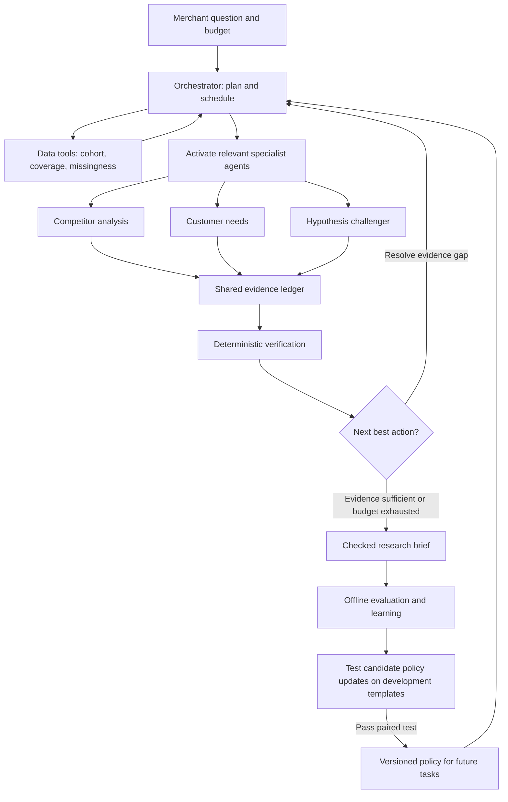

# Fixed, Adaptive or Orchestrated? Designing a Budget-Aware, Evidence-Grounded Multi-Agent System for Review-Based Market Research in Beauty Retail

**Paper draft (research in progress)** · revised 7 November 2026, replacing the 24 October proposal  
**Target venues:** ICIS 2027 (short or completed research paper) or HICSS-61. Check the calls for exact deadlines and track names.  
**Status:** The datasets are integrated and audited, a root-cause analysis has identified the failure modes the artifact must handle, and the evidence checker has been tested on real data. The agent, the orchestrator, their baselines and the task suite have not run yet. The supporting customer-context experiment (RQ3) has run. Every number in this draft is either an observed count from the audited files or is labelled as a target or an illustration.

> **What changed from the 24 October version.** (1) The venue moved from the ISMS Marketing Science Conference to ICIS / HICSS, so the paper is now framed as design science research with meta-requirements, design principles and a staged evaluation. (2) It adds a related-work section built on the 87-paper review and a gap table. (3) The fixed baseline is now strong by design, and a router arm is added, because the literature shows fixed pipelines often match agents once cost is counted. (4) The task suite grows from 40 held-out tasks to 120 held-out instances, and "trap" tasks with known confounds make open-ended findings scorable without human annotation. (5) The verbatim-quote checker becomes a design principle backed by real pilot evidence (§5.3). (6) The 5 Whys root-cause analysis is now the problem evidence behind the meta-requirements (§6.3). (7) A full aspect-based text analysis of the Amazon reviews is reported in §6.2. (8) The illustrative cost scenario moved to an appendix, and a duplicated paragraph was removed. (9) **Same day, second revision:** the artifact becomes a budget-aware, hierarchical multi-agent orchestrator with bounded, validated self-evolution of its orchestration policy (§5.4), compared against a fixed workflow, a single adaptive agent and the same orchestrator without evolution; the router arm is folded into the orchestrator's delegation decisions. (10) Reviewer-driven method fixes: labels now come from a self-refining three-model jury instead of one model (no human coders are available), every gold label is checked for semantic support, an LLM topic model audits the aspect taxonomy, a transformer encoder is compared with TF-IDF for scaling, and RQ3 is re-run leak-free with first results (§7.3).

## Abstract

Beauty brands turn customer reviews into product and go-to-market decisions, but the step from thousands of reviews to a defensible research brief is slow, and large language models (LLMs) that shorten it often produce plausible but unsupported claims. Agentic systems promise to investigate rather than summarise, and multi-agent orchestrators that delegate to specialists and improve their own policies are the current frontier. Yet fixed pipelines often match autonomous agents once cost is counted, multi-agent systems consume several times more tokens, and self-improving systems can overfit the benchmark that judges them. Following the design science paradigm, we derive six design principles for evidence-grounded market-research systems: compute numbers and never generate them, require verbatim quotes, look for disconfirming evidence, disclose the cohort, delegate and escalate only when needed, and evolve only under protected evaluation. We instantiate them in a budget-aware orchestrator whose specialists share an evidence ledger checked deterministically, running over 1.79 million deduplicated Amazon and Sephora beauty reviews. We will compare a strong fixed workflow, a single adaptive agent, the orchestrator with a fixed policy and the orchestrator after bounded self-evolution on 120 held-out research tasks from templates the system never sees, including trap tasks whose confounds are known by construction. Outcomes are verified task success, unsupported-claim rate, cost, latency and consistency, reported as a cost-accuracy frontier that includes the cost of evolution. A pilot of the evidence checker on 2,182 real products keeps unsupported recommendations at or below 10% with statistical certification, where prompting alone certifies nothing, and a leak-free test on 812,000 Sephora reviews shows that a reviewer's own history predicts their next recommendation far better than their stated skin type. The study contributes design knowledge on when added agentic sophistication is worth its cost in marketing analytics.

**Keywords:** design science, agentic AI, multi-agent orchestration, self-improving systems, market research, online reviews, evidence grounding, beauty retail

## 1. Introduction

A product manager at a beauty brand preparing a new lightweight moisturiser needs answers to questions such as: what do buyers of competing products explicitly value, which complaints recur across competitors rather than at one brand, and which positioning claims would the evidence support? Reviews contain this information, and marketing has treated them as a market-research source for fifteen years (Lee & Bradlow, 2011; Netzer et al., 2012; Timoshenko & Hauser, 2019). Turning them into a brief, however, means repeated filtering, counting, comparing and checking. An average star rating does not separate a frequent complaint from a representative need, a preference from a defect, or a product-wide pattern from one driven by a single popular item.

LLMs can now do much of this work. Fine-tuned LLMs formulate customer needs from reviews about as well as professional analysts (Timoshenko et al., 2025), and LLM perceptual maps agree with survey-based maps (Li et al., 2024). Two problems remain. First, fluent LLM reports are often poorly supported by their own citations (Liu et al., 2023), and LLMs' priors differ from customers' preferences (Goli & Singh, 2024). A brief that invents a count or a quotation is worse than no brief. Second, it is unclear whether agentic control, where the model decides which analysis to run next, adds value over a well-designed fixed workflow. A fixed three-step pipeline beat many autonomous software agents at a fraction of the cost (Xia et al., 2025), and simple baselines matched state-of-the-art agents once cost was counted (Kapoor et al., 2025). The question sharpens for the newest designs. Multi-agent research systems that delegate to parallel specialists use several times the tokens of a single agent (Anthropic, 2025) and fail in characteristic ways (Cemri et al., 2025), and systems that search over their own workflows (Hu et al., 2025; Zhang et al., 2025a, 2025b) are judged on the same benchmarks they optimise.

This paper addresses both problems with a design science study (Hevner et al., 2004; Peffers et al., 2007). We ask:

- **RQ1 (architecture and cost).** Can a self-evolving, budget-aware multi-agent orchestrator improve the accuracy-cost trade-off of evidence-backed beauty market research?
  - **RQ1a (control).** At a matched budget, do a single adaptive agent and a fixed-policy multi-agent orchestrator produce more correct and more completely supported findings than a strong fixed workflow, and on which kinds of tasks?
  - **RQ1b (evolution).** Does bounded, validated self-evolution of the orchestration policy improve held-out performance once the cost of evolving is counted?
- **RQ2 (grounding).** Which design features keep unsupported claims in a research brief low, and at what cost in coverage?
- **RQ3 (customer context).** Does evidence about customer context, such as reported skin type and earlier reviews, predict later customer recommendations beyond product popularity? This is a supporting test of whether the context the agent reports is informative.

The expected contribution is design knowledge, not a new interface. Gregor and Hevner (2013) would place it in the *improvement* quadrant: a known problem (market research from reviews) with a new solution class (evidence-grounded agents). We contribute (1) six design principles with their kernel justifications, (2) an instantiated orchestrator, a protected self-evolution protocol and an open task suite with executable oracles and trap tasks, and (3) a controlled comparison that identifies the conditions under which adaptive investigation, multi-agent delegation and self-evolution are each worth their cost. A null result is informative: if the fixed workflow matches the orchestrator, the paper reports where deterministic research automation is enough.

## 2. Related work

### 2.1 Reviews as a market-research source

Feature-based review summarisation with counts of positive and negative opinions per feature goes back to Hu and Liu (2004). Marketing adopted it as automated market research: Lee and Bradlow (2011) derive attributes and market structure from review text, Netzer et al. (2012) map brands and associations from forum posts, Archak et al. (2011) price product features from reviews, and Tirunillai and Tellis (2014) extract quality dimensions. Berger et al. (2020) set the validity standards that text-derived marketing measures must meet. IS research adds that reviewers are self-selected (Li & Hitt, 2008) and that reviews reduce product-fit uncertainty (Hong & Pavlou, 2014), both reasons why a review count is not a market size. Our brief is aspect-based opinion summarisation with traceable evidence, an established output produced in a new way.

### 2.2 LLMs in market research

Marketing journals publish LLM-based research when it is validated against human data (Li et al., 2024; Arora et al., 2025). LLMs as synthetic respondents are less reliable: their willingness-to-pay estimates generalise poorly (Brand et al., 2023), their time preferences differ from humans' (Goli & Singh, 2024), and silicon samples suit pretesting rather than inference (Sarstedt et al., 2024). Our artifact analyses real customer text, so it avoids the synthetic-respondent problem, but it inherits the duty to validate. It also motivates our first design principle: the LLM's own priors must not enter the counts.

### 2.3 Data-analysis and research agents

Benchmarks test agents on data questions with exact answers (Hu et al., 2024), on discovery tasks drawn from published analyses (Majumder et al., 2025), on the space of expert analysis decisions (Gu et al., 2024) and, closest to our setting, on business analytics with planted insights (Sahu et al., 2025). Agent designs re-plan as results arrive (Hong et al., 2025) or reuse expert cases to cut cost (Guo et al., 2024). Interactive agents choose more varied, expert-like analyses (Gu et al., 2024), which supports the adaptive arm, but the best systems still solve only a minority of open discovery tasks (Majumder et al., 2025), which supports keeping calculation in code. For report writing, STORM researches before writing (Shao et al., 2024), and DeepResearch Bench scores report quality and citation accuracy separately (Du et al., 2026).

### 2.4 Adaptive versus fixed control, and cost

Agentless (Xia et al., 2025) and *AI Agents That Matter* (Kapoor et al., 2025) are the strongest evidence for the "fixed is enough" position. Adaptive routing by question complexity improves the accuracy-efficiency trade-off (Jeong et al., 2024), and model cascades cut cost sharply (Chen, Zaharia & Zou, 2024). Three implications follow for our design: the fixed workflow must be a strong, carefully built baseline; results must be reported as a cost-accuracy frontier, not one accuracy number; and selective escalation from fixed to adaptive investigation should be part of the design.

**Multi-agent orchestration and self-improving systems.** Orchestrator-worker designs split research into parallel specialist investigations; a production research system reports large quality gains at roughly fifteen times the tokens of a chat interaction (Anthropic, 2025). A failure taxonomy of multi-agent systems finds that many failures come from specification, inter-agent misalignment and weak verification rather than model capability (Cemri et al., 2025), which argues for a shared, checked evidence record. A second line automates design itself: DSPy compiles pipelines by optimising prompts and demonstrations against a metric (Khattab et al., 2024), GPTSwarm optimises agent graphs (Zhuge et al., 2024), ADAS has a meta-agent write new agents in code (Hu et al., 2025), AFlow searches workflows with Monte Carlo tree search (Zhang et al., 2025a), and MaAS samples query-dependent multi-agent architectures under a cost budget (Zhang et al., 2025b). These systems report gains on the benchmarks they search over, usually with the evaluation set also serving as the selection signal, and rarely count the cost of the search. Our contribution is therefore not a new search method but a protected one: evolution over a small, interpretable policy space, promotion by a paired test on development templates, held-out templates the evolution never touches, and evolution cost charged to the frontier.

### 2.5 Measuring support for claims

Attribution to identified sources defines a supported statement (Rashkin et al., 2023). Long outputs can be split into atomic facts and scored for precision (Min et al., 2023), and citations scored for recall and precision (Liu et al., 2023; Gao et al., 2023). Small checkers match large models at grounding checks at low cost (Tang et al., 2024). LLM judges agree with humans about as often as humans agree with each other, but prefer longer answers (Zheng et al., 2023), a bias that would favour the adaptive arm. We therefore use programmatic checks as the primary measure and LLM judges only as a secondary one.

### 2.6 Gap

| Capability | Review mining (2.1) | LLM market research (2.2) | Analysis agents (2.3) | Adaptive vs fixed (2.4) | This study |
|---|:-:|:-:|:-:|:-:|:-:|
| Real customer reviews as the evidence base | ✓ | partly | – | – | ✓ |
| Findings with computed counts and verbatim quotes, including contrary quotes | partly | – | partly | – | ✓ |
| Adaptive vs fixed control at a matched budget | – | – | – | ✓ (software, QA) | ✓ |
| Multi-agent orchestration and self-evolution with protected held-out evaluation and evolution cost counted | – | – | – | partly (search on the test benchmark) | ✓ |
| Executable oracles for open-ended findings (trap tasks) | – | – | partly (planted insights) | – | ✓ |
| Second retailer for robustness | rare | – | – | – | ✓ (Sephora, Amazon) |

No paper we found compares fixed, adaptive and orchestrated investigation for review-based market research on correctness, unsupported claims and cost together, or scores a merchant brief at the level of atomic findings backed by computed counts and quoted reviews.

## 3. Research approach

We follow the design science research methodology of Peffers et al. (2007): problem identification (§1, with the EDA and root-cause analysis in §6), objectives as meta-requirements (§4), design and development (§5), and demonstration and evaluation (§6–§7). Evaluation follows the FEDS framework (Venable et al., 2016) with a *technical risk and efficacy* strategy. We start with artificial, formative evaluation (component tests and a development pilot), then move to artificial, summative evaluation (the held-out comparison). A naturalistic evaluation with practitioners is an optional extension (§7.4). This order fits the main risk: the artifact is only useful if its findings are correct, so correctness has to be established before usefulness.

## 4. Meta-requirements and design principles

Meta-requirements (MR) come from the merchant problem in §1 and the failure modes in §2. Each design principle (DP) answers one or more of them and names its justification.

| | Meta-requirement | Source |
|---|---|---|
| MR1 | Every number in the brief must be reproducible from the data | Goli & Singh (2024); Majumder et al. (2025) |
| MR2 | Every quotation must exist in the cited review | Liu et al. (2023); Rashkin et al. (2023) |
| MR3 | Findings must state their scope: cohort, denominators, missing data, and how products were assigned to segments | Li & Hitt (2008); Berger et al. (2020); RCA causes A and C (§6.3) |
| MR4 | The brief must expose evidence against its own findings, and rival explanations | Klayman & Ha (1987); RCA cause B (§6.3) |
| MR5 | The cost of producing the brief must be justified by what it adds over simpler automation | Kapoor et al. (2025); Xia et al. (2025) |
| MR6 | The brief must not claim outcomes the data cannot measure, such as ROI, sales or demand | RCA constraint D (§6.3) |
| MR7 | Any learned change to the system must be shown to help on tasks it was not tuned on, and its cost must be counted | Kapoor et al. (2025); Hu et al. (2025); Zhang et al. (2025a) |

| | Design principle | Addresses | Justification |
|---|---|---|---|
| DP1 | **Compute, don't generate.** Counts, proportions and comparisons come from parameterised SQL/Python. The LLM writes queries and prose, never numbers. | MR1 | LLM priors differ from customer data (Goli & Singh, 2024); code execution is checkable |
| DP2 | **Quote verbatim or don't claim.** A finding cites review or listing text that a deterministic check finds word for word in the source. | MR2 | Pilot evidence in §5.3: the verbatim requirement is what made a certified error bound reachable |
| DP3 | **Seek disconfirming evidence.** Before a finding is kept, the agent retrieves opposing reviews, checks whether one product dominates, and runs a sensitivity cut. | MR4 | Positive-test bias in hypothesis testing (Klayman & Ha, 1987); averages hide thin evidence and disagreement (Finding D; RCA cause B, §6.3) |
| DP4 | **Disclose the cohort.** Each finding records its filters, numerator, denominator, the share of records excluded for missing fields, and the rule that assigned products to its segment. Claims are typed, and the schema has no field for ROI, sales or demand. | MR3, MR6 | Only 3.85% of Amazon products have complete listings, and a keyword rule put a leather conditioner in Hair care (§6.3) |
| DP5 | **Delegate and escalate only when needed.** Simple calculations go straight to tools; specialists are activated only for the parts of a question that need them; investigation continues only while an open question could change the brief, and stops at the budget. | MR5 | Adaptive routing (Jeong et al., 2024); cascades (Chen, Zaharia & Zou, 2024); multi-agent token cost (Anthropic, 2025) |
| DP6 | **Evolve only under protected evaluation.** Policy changes are proposed between tasks, tested on development templates with a paired test, versioned with rollback, and never see held-out templates, answer keys or the evaluator. | MR7 | Overfitting of self-optimised systems to their selection set; adaptive data analysis (Dwork et al., 2015) |

DP5 and DP6 are themselves hypotheses: if the orchestrator matches the single agent at lower cost, DP5 is supported; if the evolved policy beats the fixed policy on held-out templates after paying for its evolution, DP6 is supported.

## 5. Artifact

### 5.1 What it does

The user gives a category, a focal product or concept, a set of competitors and a research question. The artifact returns a brief with five sections: customer-need observations, competitor comparison, recurring objections with contrary evidence, candidate positioning hypotheses, and proposed validation tests. Each finding is a structured record:

`claim_type, cohort, numerator, denominator, query_id, source_ids, supporting_quotes, contrary_quotes, rival_explanations_checked, limitations, proposed_test`

A positioning suggestion is labelled as a hypothesis. The artifact does not publish campaigns, change listings, claim treatment efficacy, or infer sales from reviews. A claimed product attribute must come from the product's own listing, never from customer complaints alone.

### 5.2 Control arms over one tool set

All arms use the same models, tools, data and budget caps. Only the control logic differs, which isolates control from tool access (H3 in §7.1).

| Arm | Control | Purpose |
|---|---|---|
| **F, fixed workflow** | A fixed sequence of the same tools: scope → cohort query → aspect counts → quote retrieval → contrary-quote retrieval → dominance and sensitivity checks → write → check. Tuned on development tasks as carefully as the agent. | Strong baseline, as Agentless demands |
| **A, adaptive agent** | A single controller (ReAct-style; Yao et al., 2023) that chooses the next tool from the results so far, within the budget cap | The treatment |
| **M, orchestrator (fixed policy)** | The budget-aware multi-agent orchestrator of §5.4 with its policy frozen after the development pilot. Includes selective escalation: simple calculations go straight to tools (DP5) | Tests delegation to specialists over one adaptive controller |
| **M+, orchestrator (evolved policy)** | M after bounded self-evolution of its policy on development templates (§5.4) | Tests whether validated self-evolution pays for itself |
| **B, retrieval baseline** | Retrieval-augmented LLM synthesis over precomputed tables, without code execution | Shows what DP1–DP4 add |
| **S, script** | Deterministic SQL template report, no LLM | Floor for cost and correctness |

The tools are: cohort and SQL query, aspect counter, review and listing search, quote fetcher, verbatim checker, dominance check (share of a finding driven by its top product), sensitivity rerun, and schema validator. Review text is treated as untrusted data and never as instructions to the agent.

The arms form a chain of single changes: F → A adds adaptive control, A → M adds delegation to specialists with a shared ledger, and M → M+ adds evolution. B and S are floors.

### 5.3 Evidence checker: prior evidence from a real pilot

The verbatim checker (DP2) is the one component already tested on real data, in an earlier study in this project on matching beauty listings to customer needs (EvidenceGuard; `05-report/report.md`, 18 October 2026). There, an LLM had to decide whether a listing supports a customer need. A verifier that had to quote the listing verbatim and name the needed value was compared with confidence scores and a strict "only if stated" prompt. Thresholds were calibrated with Learn-then-Test (Angelopoulos et al., 2024) on 2,182 real All_Beauty products, one item per product, over 50 product-disjoint splits:

| Matcher (Claude Sonnet / Haiku) | Splits certifying unsupported-recommendation rate ≤ 10% | Test unsupported rate | Recall of supported listings |
|---|---|---|---|
| Verbatim-quote verifier | 100% / 100% | 4.0% / 4.1% | 88% / 90% |
| Same LLM outputs without the verbatim check | 0% / 0% | – | – |
| Strict "only if stated" prompt | 0% / 0% | – | – |

Two lessons carry over. Requiring a verbatim, typed quote is what made a certified error bound reachable, so it is a design principle and not just a filter. Its weak spot is paraphrased evidence: in the same project, recall fell to 0–2% when the listing stated the attribute in other words. In this artifact, a finding that rests only on paraphrase is therefore reported as *interpretation*, separate from *quoted evidence*, and the share of findings in each class is a reported outcome. The pilot concerns listing-need matching, not market-research briefs, so it is supporting evidence for DP2, not a result of this study.

### 5.4 Budget-aware orchestrator with protected self-evolution

The objective is the highest verified research quality within a stated cost and time budget. No configuration can be called the most advanced or most efficient in advance; which one achieves the objective is what Experiment 1 tests.

**Five orchestration decisions.**

| Decision | How it is made |
|---|---|
| Who should work? | Activates only the specialists the question needs; simple calculations go directly to tools |
| What can run together? | Runs independent investigations in parallel and waits where one depends on another |
| Where should effort go? | Prioritises open questions most likely to change the brief's conclusions |
| What needs correction? | Returns a failed claim to the specialist that made it, with the specific verification error |
| When should work stop? | When evidence requirements are met, the expected gain of further work is small, or the budget runs out |

**Efficiency by design.** Aggregation over millions of records runs in SQL and Python next to the data, and agents receive tables and selected excerpts (DP1). Agents exchange finding records, query ids and source ids from the ledger, not conversation histories. Results are cached by dataset version, cohort and query. Smaller models do bounded extraction and stronger models plan and synthesise, a split the benchmark tests rather than assumes. A failed query or branch is rerun locally without restarting the brief, and execution state is checkpointed so interrupted tasks resume.

**Bounded self-evolution (DP6).** Between tasks, a proposer reads development-run logs (which checks failed, where budget went) and proposes one change to the orchestration policy. The policy space is deliberately small and interpretable: specialist activation rules, the order of checks (for example, running a product-concentration check early for texture questions if those briefs often fail it), concurrency limits, model routing per role and the stopping thresholds. Prompts, tool code, the verifier and the evaluator are outside the space. A candidate is run on all development instances (10 templates × 4 cohorts × 3 runs) and promoted only if a paired comparison with the incumbent shows higher all-checks success, or equal success within the margin at lower cost; at most 10 candidates are tried, with Holm correction across them. Every promoted policy is versioned and can be rolled back. Held-out templates, answer keys and the oracle code are never visible to the proposer or the promotion test. The tokens and time spent on proposals and development runs are the **cost of evolution**, reported in total and as the number of future briefs needed to recover it.

## 6. Data

### 6.1 Sources and audit

All counts come from the supplied files and full-file integration scripts. Review counts exclude exact duplicates unless marked raw; catalogue counts include products without collected reviews.

| Metric | Amazon All Beauty | Sephora |
|---|---:|---:|
| Catalogue products | 112,590 | 8,494 |
| Raw reviews | 701,528 | 1,094,411 |
| Reviews after exact deduplication | 694,253 | 1,094,187 |
| Products with collected reviews | 112,565 | 2,351 |
| Unique reviewers | 631,986 | 503,216 |
| Reviewers with ≥ 2 distinct products | 42,823 | 209,105 |
| Reviewers with ≥ 5 distinct products | 1,471 | 40,433 |
| Existing binary recommendation labels | none | 926,314 |

**Finding A: complete-case analysis would change the population.** Only 17,704 Amazon products have a price (15.72%), and requiring price, description and features keeps 4,332 (3.85%). The artifact must disclose cohort sizes and missingness (DP4).

**Finding B: Sephora is the main environment for customer context.** 93.22% of Amazon reviewers have one observed product, against 209,105 Sephora reviewers with two or more. These are reviewed-product histories, not purchase records.

**Finding C: Sephora supplies outcomes without new annotation.** It has 926,314 recommendation labels (778,061 positive, about 84%), so a majority-class baseline is essential. A further 167,873 labels are missing and stay missing. 412,406 labelled reviews have a strictly earlier review of another product by the same author, which is the eligible pool for RQ3, not a test-set size. Customer profiles are undated snapshots.

**Finding D: averages hide disagreement.** Of 14,519 five-star Amazon products, 12,189 (83.95%) have fewer than five ratings. 4,712 products have at least 20 reviews with at least three low and three high ratings. These are candidates for disagreement analysis, with shipping, defects and variants as rival explanations.

**Finding E: no cross-source linkage.** All reviews match a product within their own source. No Amazon–Sephora product or customer link exists, so the sources are analysed separately. Amazon is the robustness domain.

### 6.2 Review text analysis (Amazon All_Beauty)

An aspect-based sentiment analysis of all 693,547 cleaned Amazon reviews ([method and code](../text_analysis/README.md), [results](../text_analysis/outputs/amazon/results.md), [metadata join](../text_analysis/outputs/amazon/meta_results.md), [listing NLP](../text_analysis/outputs/amazon/listing_nlp.md), [taxonomy audit](../text_analysis/outputs/amazon/topicgpt.md)) gives the baseline the artifact's analysis layer must reproduce. It is built to stand without human coders, which this study does not have:

1. **Self-refining labelling guide** ([codebook.py](../text_analysis/codebook.py)). Claude Haiku and Claude Sonnet label a 240-review development sample under one guide (16 aspects, a polarity and a verbatim quote per aspect, 12 customer-context tags). Claude Opus adjudicates every disagreement and turns ambiguities into general rules, and the guide is rewritten until agreement stops improving. This is iterative codebook development with model coders (Madaan et al., 2023; Verga et al., 2024). Two rounds produced 20 rules, and macro Cohen's kappa between the two coders rose from 0.80 to 0.87 on the development sample. On a separate 200-review held-out sample it rose from 0.81 to 0.83, and exact agreement on the full label set from 55% to 64%. Context-tag kappa fell on the held-out sample (0.84 to 0.72, few positives), so context shares are the least reliable labels.
2. **Jury gold labels.** On the 1,500-review random calibration sample, both coders label every review under the final guide, and the 37.5% of reviews where they disagree are adjudicated. The cheap coder agrees with the jury at macro kappa 0.91, which is why it is used for the 2,000-review training sample.
3. **Semantic support check** ([entail.py](../text_analysis/entail.py)). A verbatim quote proves the text exists, not that it supports the label. Claude Opus judged every gold label against its quote. On a known-answer contrast set it accepted 99.0% of original labels and rejected 97.9% of perturbed ones: 99.7% with flipped polarity, 100% with a swapped aspect, and 92.7% with another label's quote. It judged 9.4% of verbatim gold labels unsupported, most often for texture (21%) and the generic overall verdict (14%), and these were dropped.
4. **Scaling with valid intervals.** A TF-IDF word and character n-gram classifier trained on the labels is applied to every review. Shares are estimated by prediction-powered inference (PPI++; Angelopoulos et al., 2023) against the gold sample, which keeps them unbiased with valid 95% intervals for what the jury would say about every review. A pretrained sentence encoder (BGE; Xiao et al., 2024) is the planned replacement classifier; it must run on a machine with model access.
5. **Taxonomy audit.** An LLM topic model (TopicGPT; Pham et al., 2024) generated 29 topics from 400 reviews and assigned them to the calibration sample. 36.2% [33.8, 38.7] of reviews discuss at least one theme the 16 aspects do not cover, mainly fit and size (9.3%), look and style (9.0%), comfort in use (5.8%), portability and storage (4.3%), compatibility with other products (3.9%) and residue (2.9%). Many come from wigs, tools and devices in the All_Beauty category. These become candidate aspects for the next labelling round.

The guide changed some definitions, so figures differ from the single-model version: breakage and build defects now count as quality rather than efficacy. Main results:

- **Most reviews are generic.** 58.5% [56.3, 60.7] give an overall verdict. Efficacy is the most discussed specific aspect (27.8% [26.0, 29.6]), followed by quality and authenticity (18.5% [16.9, 20.0]).
- **Low ratings are mostly not about the product's effect.** Among 1–2★ reviews, 24.1% [20.0, 28.2] criticise efficacy, but 34.4% [29.9, 39.0] criticise quality or authenticity (breaks, fake, not as described), 12.1% [9.0, 15.2] size or quantity, 7.6% [4.7, 10.5] packaging and 5.7% [3.3, 8.2] delivery or service. A brief that reads low stars as product-experience problems would be wrong for most of them, which is RCA cause B in text form.
- **Customer context is rarely stated.** Repeat purchase is stated in 3.4% [2.5, 4.3] of reviews and gift in 3.1% [2.3, 3.9]. No skin or hair type exceeds 0.9%. This is why Sephora, with structured skin-type fields, is the main context environment.
- **Criticism is not concentrated in a few products.** No product accounts for more than 3.2% of any aspect's predicted criticism (products with ≥ 20 reviews), so most complaint patterns are category-wide. Concentration is a classifier estimate without an interval.
- **Criticism has risen over time.** The share of reviews with a negative overall verdict rose from 7.0% [3.6, 10.4] up to 2015 to 14.5% [11.6, 17.4] in 2021–23. Price criticism rose from 1.5% [0.0, 3.0] to 5.0% [3.1, 6.9]. Time windows therefore belong in the cohort definition (DP4).
- **What gets criticised depends on the segment** (product metadata joined by product id; segments are the EDA's title keyword rules). Quality and authenticity criticism appears in 23.7% [17.6, 29.8] of hair-extension and wig reviews, 16.4% [10.7, 22.1] of nail and 13.3% [9.2, 17.4] of makeup reviews, but 5.1% [2.3, 7.8] of skin-care reviews. Efficacy criticism is highest for grooming and removal (13.7% [6.2, 21.2]) and skin care (10.2% [6.3, 14.1]). Listings with no price draw more quality criticism (12.6% [11.1, 14.2]) than priced ones (4.9–8.6%), and incomplete listings more than complete ones (11.7% [10.3, 13.1] vs 4.6% [1.5, 7.7]). A category-level brief must therefore be segment-specific.
- **Listing claims make the claimed aspect a target.** 84.6% of listings have no feature bullets and 83.1% no description, so most claims sit in the title. Where the listing claims a scent, 9.1% [3.3, 14.9] of reviews criticise the scent against 2.3% [1.6, 3.0] elsewhere (+6.8 points [+1.0, +12.7]). Where it claims hydration, hydration criticism is +3.1 points [+0.1, +6.1]. Long-lasting, gentle, easy-to-use, multipack and premium claims show no difference distinguishable from zero. Ingredient claims could not be tested because too few gold labels criticise ingredients. This is descriptive: products that make claims differ in other ways.

These figures feed the task suite: the oracle for "what are low ratings about" tasks and the dominance check use the same labels and the same PPI estimator. The single-model results are kept in `outputs/amazon/v0_labels/` for comparison. The Sephora run uses the same code once the Claude CLI is signed in on the Mac.

### 6.3 Root-cause analysis: why review-based marketing decisions go wrong

A 5 Whys analysis of the Amazon catalogue ([analysis](../output/beauty_5whys/analysis.md), [evidence](../output/beauty_5whys/evidence.json)) asked why marketing decisions drawn from it can be unreliable. Each chain stops where the evidence runs out instead of inventing five answers. It found four operational causes. Each one becomes a requirement for the artifact and a trap task in the evaluation.

| | Symptom | Verified operational cause | Unverified (stopped) | Requirement | Trap (§7.2) |
|---|---|---|---|---|---|
| A | A complete-record shortlist keeps 4,332 of 112,590 products (3.85%); 80,031 lack price, description and features | Using completeness as an eligibility rule; the population shifts (median rating count 9 overall, 20 in the complete subset) | Why the fields are missing upstream | MR3, DP4 | (d) |
| B | 12,189 of 14,519 five-star products have fewer than five ratings, and 5,931 have one | Ranking on average stars ignores evidence volume. A ≥ 4.5 rule selects 31,004 products (median 5 ratings); adding ≥ 20 ratings keeps 7,472 (median 64) | Why those products have few ratings | MR4, DP3 | (b) |
| C | A leather conditioner is classed as Hair care | A context-free keyword rule assigns segments, and the file's category paths are all empty, so it cannot be checked | Why category paths are empty upstream | MR3, DP4 | (e) |
| D | The file cannot show marketing ROI | The data unit is a product with aggregate feedback, not an exposure, click or purchase | – | MR6, DP4 | – (enforced by the schema) |

Two later chains use the review-text evidence of §6.2 (E and F in the [analysis](../output/beauty_5whys/analysis.md)): low star ratings mix product failure with listing-accuracy, packaging and delivery problems, so star share is not a product-performance measure (supports MR4 and trap type (b)); and claimed aspects draw more criticism of that aspect, which a brief may report only as an association (supports MR6). The RCA establishes no root cause for missing prices, low demand, review fraud or poor marketing performance, and the paper claims none. Its role is problem identification in the design science sense (Peffers et al., 2007): it shows, on the real data, the failure modes that an unaided analyst or a summarising LLM would carry into a brief. An earlier 5 Whys in this project (`FIVE_WHYS_ANALYSIS.md`) studied cold-start mismatch for the EvidenceGuard study and is not used here.

Evidence: [Amazon summary](../output/beauty_reviews/summary.json), [Amazon evidence ledger](../output/beauty_research_workflow/evidence_ledger.json), [Sephora summary](../output/sephora/summary.json), [Sephora provenance](../data/sephora_sources.json).

## 7. Evaluation design

### 7.1 Hypotheses

- **H1 (adaptive value).** A achieves higher all-checks task success than F at a matched budget.
- **H2 (fixed is enough).** F matches A and M within a pre-set margin; adaptivity and delegation add cost, not accuracy.
- **H3 (tools, not control).** Any gain of A or M over B disappears once F, which has the same tools, is the comparison.
- **H4 (orchestration).** M matches or beats A on success at a lower cost per brief, because selective delegation and local repair avoid wasted investigation (DP5).
- **H5 (where adaptivity helps).** Any advantage of A or M over F is concentrated in trap tasks (§7.2), where the right next analysis depends on an earlier result.
- **H6 (evolution).** M+ beats M on held-out all-checks success at equal or lower cost per brief, and the cost of evolution is recovered within a stated number of briefs (DP6).
- **H7 (context).** In RQ3, customer-context features add predictive value beyond popularity, and the gain disappears under shuffled profiles.

H1 and H2 are rival hypotheses, so either outcome answers RQ1a; H6 answers RQ1b.

### 7.2 Experiment 1 (primary): research tasks with executable oracles

**Task suite.** 40 task templates instantiated on 4 category cohorts each, giving 160 instances: 40 for development (10 templates, all cohorts) and 120 held out (the other 30 templates, all 4 cohorts). Held-out templates are never seen during design or by the self-evolution loop, so M+ cannot learn their answer keys through shared templates. Each instance runs three times per arm. Templates come in four families:

1. **Cohort and count**, e.g. "For moisturisers with at least 50 reviews, compare the recommendation rate by reported skin type, give the denominators, and say which groups fail the minimum-sample rule."
2. **Comparison**, e.g. price bands and complaint rates across a focal product and its competitors.
3. **Evidence retrieval**, e.g. find reviews that state a named aspect, with verbatim quotes.
4. **Trap tasks.** Each contains a confound that is known by construction, so the correct finding is known without labelling any review. Examples: (a) a complaint whose cohort-wide rate is driven above half by one product, which a correct brief must flag; (b) a subgroup below the sample-size rule; (c) a premise in the question that contradicts the data, such as "why do oily-skin reviewers rate this lower?" when they don't; (d) a pattern that reverses when products with missing listing fields are included; (e) a segment that contains products a keyword rule misassigned, such as the leather conditioner in Hair care. Each trap type comes from a verified cause in the RCA (§6.3). Traps are selected from real cohorts where the confound occurs naturally, and their oracle is a query. They test DP3 and DP4 and are where H5 predicts adaptivity matters.

Oracle queries are written and checked against the full data before any arm runs, and are never visible to the arms.

**Metrics.**

| Metric | Definition | Primary? |
|---|---|---|
| All-checks task success | Every required number within tolerance, every required field present, every quote verbatim, trap flagged (trap tasks) | **Yes** |
| Atomic-finding precision | Share of atomic findings whose numbers match the oracle and whose quotes pass the verbatim check (after Min et al., 2023) | Yes |
| Unsupported-claim rate | Share of atomic findings with no reproducible query or quote | Yes |
| Contrary-evidence recall | On trap tasks, share of planted confounds the brief reports | Yes |
| Citation precision and recall | After Liu et al. (2023) | Secondary |
| Quoted vs interpretation share | §5.3 | Reported |
| Run-to-run consistency | Agreement of findings across the three runs | Yes |
| Latency | Wall-clock time per brief | Yes |
| Cost of evolution (M+) | Tokens and time for proposals and development runs; briefs needed to recover it | Yes |
| Cost | Tokens, tool calls, wall-clock time, API cost | Yes, as the frontier axis |

**Budget matching and the frontier.** Each arm runs at three budget caps (tokens and tool calls), and results are reported as a cost-success frontier (Kapoor et al., 2025). The primary comparison is at the middle cap.

**Ablations.** On A and M: remove replanning (it becomes F), the verbatim check (DP2), contrary-evidence retrieval and the hypothesis challenger (DP3), and cohort disclosure (DP4), one at a time. On M: replace model routing by the strong model everywhere, and run specialists sequentially instead of in parallel.

**Analysis.** Mixed-effects logistic regression of task success on arm, with random intercepts for template and cohort, and a template-cluster bootstrap for differences. The equivalence margin for H2 and the power analysis are fixed after the development pilot and before held-out runs, and registered in the repository. LLM judges may score brief readability as an exploratory measure, never a primary one.

### 7.3 Experiment 2 (supporting): customer context and later recommendations

Uses only observed Sephora `is_recommended` labels, with a frozen chronological split; same-day events are treated as simultaneous. Inputs exclude the target review's text, title, rating and label. Histories are strictly earlier, and a stricter condition also excludes target-product history. Near-duplicate text across splits is audited, and repeated product families are isolated in a held-out-product evaluation. Undated profile fields get a sensitivity analysis.

Models: majority and popularity, structured customer and history features, text embeddings, and LLM-assisted evidence aggregation. Conditions: no profile, observed profile, shuffled profile. Metrics: macro-F1, balanced accuracy, AUROC, PR-AUC, log loss and calibration, with customer-cluster bootstrap intervals and product-cluster checks. Unreviewed products are not negative outcomes, because exposure is unknown. Amazon ratings provide a separate ordinal robustness analysis, not a pooled replication.

**First result (leak-free core models; [code](../text_analysis/rq3_temporal.py)).** Every feature is computed from reviews submitted on earlier days only, and models are fitted before a global cutoff (8 February 2022) and tested after it: 618,182 training and 193,758 test reviews with a recommendation label. Gradient-boosted trees with three nested feature sets give:

| Model | Features | AUROC, all test reviews | AUROC, returning customers (n = 117,877) |
|---|---|---|---|
| M0 popularity | Product's prior recommend rate, review count and mean rating; category rate | 0.684 | 0.695 |
| M1 + stated context | M0 + skin type and the product's prior rate among same-skin-type reviewers | 0.689 (Δ +0.004, 95% CI +0.004 to +0.005) | 0.698 (Δ +0.003, CI +0.002 to +0.004) |
| M2 + reviewer history | M1 + the reviewer's earlier reviews: count, recommend rate, mean rating, rate in the same category | 0.754 (Δ +0.070, CI +0.067 to +0.073) | 0.807 (Δ +0.112, CI +0.108 to +0.117) |

Intervals are cluster-bootstrap over reviewers for the difference from M0. Stated skin type carries real but very small information beyond popularity; the reviewer's own history carries much more. For the artifact, this means a brief should weight what returning customers did before over what reviewers say about themselves, and should not present skin-type segments as strong drivers without evidence. The shuffled-profile control, the held-out-product condition and the text-embedding model are still to run, so H7 is not yet tested in full.

### 7.4 Optional naturalistic evaluation

IS reviewers often expect evidence that the artifact is useful, not only correct. If access allows, three to five beauty marketing or product practitioners would compare briefs from F, A, M+ and S on six held-out questions, blind to arm, and rate decision usefulness and trust, and say which findings they would act on. This needs human participants and ethics approval, but no review annotation. Without it, the paper claims correctness and cost only, and lists usefulness as future work.

### 7.5 What the evaluation cannot show

Executable checks establish mechanical correctness and bounded task performance. They do not establish that every interpretation is right, that a market-entry decision is good, or that a complaint reflects unmet demand. Review frequency is not market size. Willingness to pay, staff productivity and sales impact are outside this study.

## 8. Expected contributions

1. **Design principles DP1–DP6** for evidence-grounded research agents and orchestrators, each tied to a meta-requirement and to empirical evidence (Gregor & Hevner, 2013, improvement).
2. **An open artifact and task suite**: 160 task instances with executable oracles over two real beauty retailers, including trap tasks, which make open-ended research findings scorable without human annotation.
3. **A controlled answer to "adaptive or fixed?"** for marketing analytics, reported as a cost-accuracy frontier, with the task families where adaptivity pays off, if any.
4. **A protected self-evolution protocol** (DP6): a bounded policy space, paired promotion on development templates, locked held-out templates and the cost of evolution charged to the frontier, reusable for any self-improving agent evaluation.
5. **Evidence on customer context** (RQ3): first results show reviewer history, far more than stated skin type, predicts later recommendations beyond popularity.

**Falsifiers.** If F matches A and M within the margin on every task family, the paper reports H2 and narrows its claim to DP1–DP4 and the task suite. If M+ does not beat M on held-out templates, or needs more briefs to recover its evolution cost than a merchant would run, the paper reports that self-evolution did not pay. If context gains in RQ3 vanish under shuffled profiles or popularity controls, the paper drops the customer-context claim.

## 9. Threats to validity

- **Construct.** Task success measures correct execution, not strategic value. Trap tasks cover five confound types taken from the RCA, not all possible confounds.
- **Internal.** Prompt tuning effort could favour one arm. Both F and A get the same development budget and the same development tasks, and the tuning log is published.
- **External.** Two retailers, one category family, old snapshots and self-selected reviewers. No population-demand or causal claim follows.
- **Statistical.** Templates, not instances, are the unit of generalisation. Clustering by template addresses this, and 30 held-out templates is the main limit on power.
- **Evolution overfitting.** With 10 development templates, a promoted policy may fit them by chance. The paired test, the cap of 10 candidates with Holm correction and the template-disjoint held-out set bound this, and the held-out set is used once.
- **Multi-agent cost.** Orchestration can multiply tokens. All comparisons are at matched budget caps, and cost per brief is a primary outcome, not a footnote.
- **Label validity without human coders.** The review-text labels used by the oracles are a three-model jury under a self-refined guide, checked for verbatim and semantic support (§6.2). They measure model consensus under an explicit guide, not human judgement. All three models come from one family, so shared biases are not removed. The guide, every adjudication and every rule are published so a human audit can be added.
- **Model dependence.** Results may change with the model. The main comparison uses one model, with a replication on a second model family if budget allows.

## 10. Status and plan

| Part | Status |
|---|---|
| Amazon and Sephora integration, deduplication, EDA (Findings A–E) | Done, reproducible from `beauty-research/scripts/` |
| 5 Whys root-cause analysis (§6.3) | Done, `beauty-research/output/beauty_5whys/` |
| Review text analysis, aspect-based sentiment (§6.2) | Done for Amazon (693,547 reviews) with jury labels, semantic support check and taxonomy audit; Sephora waits on the Mac CLI sign-in; encoder classifier waits on the Mac |
| Verbatim evidence checker | Tested on 2,182 real products in the earlier study (§5.3) |
| Related work (87 papers) | Done, in PR #10 |
| Task templates and oracle queries | To build |
| Arms F, A, M, M+, B, S and the self-evolution loop | To build; no LLM run yet |
| Experiment 1 | Not run; no results exist |
| Experiment 2 core models (leak-free time split) | Done on Sephora (§7.3); shuffled-profile and held-out-product conditions to run |

**Ten-week plan.** Week 1: write 40 templates and oracle queries; select trap cohorts for the five RCA-derived trap types. Week 2: development pilot of F and A on 10 templates; freeze the record schema. Weeks 3–4: build M (orchestrator, specialists, ledger), B and S; freeze M's initial policy, budgets, margins and the analysis plan. Week 5: self-evolution on development templates only (at most 10 candidates), producing M+. Weeks 6–7: held-out runs of all arms and ablations. Week 8: remaining Experiment 2 conditions. Weeks 9–10: analysis and writing. Model choice and an API budget must be agreed before paid runs; on today's evidence the subscription CLI's usage limit is a binding constraint, so held-out runs need API access.

**Venue choice.** HICSS takes research in progress and suits a first submission with Experiment 1 (F, A, M) alone, with M+ as planned work. ICIS completed research needs both experiments and ideally §7.4. A short paper to ICIS with the design principles and pilot results is the middle option.

## Appendix A: illustrative business case (not a result)

Assume 10 briefs a month, 12 staff hours per brief without the artifact and 6 with it (including checking), labour at $40 an hour, and $15 of AI cost per brief. Released capacity is 10 × 6 = 60 hours, worth $2,400 a month, less $150 of AI cost: $2,250 a month before implementation and maintenance. These figures are assumptions and must not appear as findings. Released time saves cash only if spending actually falls. A 30–50% effort reduction is a possible target for a later workflow pilot, not an estimate.

| Decision stage | Brief output | Evidence boundary |
|---|---|---|
| Product discovery | Recurring needs and frustrations | Review frequency is not market size |
| Concept development | Competitor strengths, objections and trade-offs | No formulation or manufacturing validation |
| Positioning | Audience and message hypotheses | No proven willingness to pay |
| Launch preparation | Product-page clarifications, FAQs, test plan | Claims need supporting product facts |
| Post-launch learning | Updated customer-experience evidence | No causal attribution from reviews |

## References

- Angelopoulos, A. N., Bates, S., Fannjiang, C., Jordan, M. I., & Zrnic, T. (2023). Prediction-powered inference. *Science, 382*(6671), 669–674.
- Angelopoulos, A. N., Bates, S., Fisch, A., Lei, L., & Schuster, T. (2024). Conformal risk control. *ICLR*.
- Anthropic. (2025). *How we built our multi-agent research system* [Engineering blog]. https://www.anthropic.com/engineering/multi-agent-research-system
- Archak, N., Ghose, A., & Ipeirotis, P. G. (2011). Deriving the pricing power of product features by mining consumer reviews. *Management Science, 57*(8), 1485–1509.
- Arora, N., Chakraborty, I., & Nishimura, Y. (2025). AI-human hybrids for marketing research. *Journal of Marketing, 89*(2), 43–70.
- Berger, J., Humphreys, A., Ludwig, S., Moe, W. W., Netzer, O., & Schweidel, D. A. (2020). Uniting the tribes: Using text for marketing insight. *Journal of Marketing, 84*(1), 1–25.
- Brand, J., Israeli, A., & Ngwe, D. (2023). *Using LLMs for market research* (HBS Working Paper 23-062).
- Campos, P. G., Díez, F., & Cantador, I. (2014). Time-aware recommender systems: A comprehensive survey and analysis of existing evaluation protocols. *User Modeling and User-Adapted Interaction, 24*(1–2), 67–119.
- Cemri, M., Pan, M. Z., Yang, S., et al. (2025). *Why do multi-agent LLM systems fail?* (arXiv:2503.13657).
- Chen, L., Zaharia, M., & Zou, J. (2024). FrugalGPT. *Transactions on Machine Learning Research*.
- Du, M., Xu, B., Zhu, C., Wang, X., & Mao, Z. (2026). DeepResearch Bench. *ICLR*.
- Dwork, C., Feldman, V., Hardt, M., Pitassi, T., Reingold, O., & Roth, A. (2015). The reusable holdout: Preserving validity in adaptive data analysis. *Science, 349*(6248), 636–638.
- Gao, T., Yen, H., Yu, J., & Chen, D. (2023). Enabling large language models to generate text with citations. *EMNLP*.
- Goli, A., & Singh, A. (2024). Frontiers: Can large language models capture human preferences? *Marketing Science, 43*(4), 709–722.
- Gregor, S., & Hevner, A. R. (2013). Positioning and presenting design science research for maximum impact. *MIS Quarterly, 37*(2), 337–355.
- Gu, K., et al. (2024). BLADE: Benchmarking language model agents for data-driven science. *Findings of EMNLP*.
- Guo, S., Deng, C., Wen, Y., Chen, H., Chang, Y., & Wang, J. (2024). DS-Agent. *ICML*.
- Hevner, A. R., March, S. T., Park, J., & Ram, S. (2004). Design science in information systems research. *MIS Quarterly, 28*(1), 75–105.
- Hong, S., et al. (2025). Data Interpreter: An LLM agent for data science. *Findings of ACL*.
- Hong, Y., & Pavlou, P. A. (2014). Product fit uncertainty in online markets. *Information Systems Research, 25*(2), 328–344.
- Hu, M., & Liu, B. (2004). Mining and summarizing customer reviews. *KDD*, 168–177.
- Hu, S., Lu, C., & Clune, J. (2025). Automated design of agentic systems. *ICLR*.
- Hu, X., et al. (2024). InfiAgent-DABench: Evaluating agents on data analysis tasks. *ICML*.
- Jeong, S., Baek, J., Cho, S., Hwang, S. J., & Park, J. C. (2024). Adaptive-RAG. *NAACL*, 7036–7050.
- Ji, Y., Sun, A., Zhang, J., & Li, C. (2023). A critical study on data leakage in recommender system offline evaluation. *ACM Transactions on Information Systems, 41*(3), 1–27.
- Kapoor, S., Stroebl, B., Siegel, Z. S., Nadgir, N., & Narayanan, A. (2025). AI agents that matter. *Transactions on Machine Learning Research*.
- Khattab, O., et al. (2024). DSPy: Compiling declarative language model calls into self-improving pipelines. *ICLR*.
- Klayman, J., & Ha, Y.-W. (1987). Confirmation, disconfirmation, and information in hypothesis testing. *Psychological Review, 94*(2), 211–228.
- Lee, T. Y., & Bradlow, E. T. (2011). Automated marketing research using online customer reviews. *Journal of Marketing Research, 48*(5), 881–894.
- Li, P., Castelo, N., Katona, Z., & Sarvary, M. (2024). Frontiers: Determining the validity of large language models for automated perceptual analysis. *Marketing Science, 43*(2), 254–266.
- Li, X., & Hitt, L. M. (2008). Self-selection and information role of online product reviews. *Information Systems Research, 19*(4), 456–474.
- Liu, N. F., Zhang, T., & Liang, P. (2023). Evaluating verifiability in generative search engines. *Findings of EMNLP*, 7001–7025.
- Madaan, A., et al. (2023). Self-Refine: Iterative refinement with self-feedback. *NeurIPS*.
- Majumder, B. P., et al. (2025). DiscoveryBench. *ICLR*.
- Min, S., et al. (2023). FActScore. *EMNLP*, 12076–12100.
- Netzer, O., Feldman, R., Goldenberg, J., & Fresko, M. (2012). Mine your own business. *Marketing Science, 31*(3), 521–543.
- Peffers, K., Tuunanen, T., Rothenberger, M. A., & Chatterjee, S. (2007). A design science research methodology for information systems research. *Journal of Management Information Systems, 24*(3), 45–77.
- Pham, C. M., Hoyle, A., Sun, S., Resnik, P., & Iyyer, M. (2024). TopicGPT: A prompt-based topic modeling framework. *NAACL*.
- Rashkin, H., et al. (2023). Measuring attribution in natural language generation models. *Computational Linguistics, 49*(4), 777–840.
- Sahu, G., et al. (2025). InsightBench: Evaluating business analytics agents through multi-step insight generation. *ICLR*.
- Sarstedt, M., Adler, S. J., Rau, L., & Schmitt, B. (2024). Using large language models to generate silicon samples in consumer and marketing research. *Psychology & Marketing, 41*(6), 1254–1270.
- Shao, Y., et al. (2024). Assisting in writing Wikipedia-like articles from scratch with large language models (STORM). *NAACL*.
- Tang, L., Laban, P., & Durrett, G. (2024). MiniCheck. *EMNLP*.
- Timoshenko, A., & Hauser, J. R. (2019). Identifying customer needs from user-generated content. *Marketing Science, 38*(1), 1–20.
- Timoshenko, A., Mao, C., & Hauser, J. R. (2025). *Transforming the voice of the customer: Large language models for identifying customer needs* (arXiv:2503.01870).
- Tirunillai, S., & Tellis, G. J. (2014). Mining marketing meaning from online chatter. *Journal of Marketing Research, 51*(4), 463–479.
- Tunstall, L., et al. (2022). *Efficient few-shot learning without prompts* (SetFit; arXiv:2209.11055).
- Venable, J., Pries-Heje, J., & Baskerville, R. (2016). FEDS: A framework for evaluation in design science research. *European Journal of Information Systems, 25*(1), 77–89.
- Verga, P., et al. (2024). *Replacing judges with juries: Evaluating LLM generations with a panel of diverse models* (arXiv:2404.18796).
- Xia, C. S., Deng, Y., Dunn, S., & Zhang, L. (2025). Agentless: Demystifying LLM-based software engineering agents. *Proceedings of the ACM on Software Engineering, 2*(FSE).
- Xiao, S., Liu, Z., Zhang, P., & Muennighoff, N. (2024). C-Pack: Packed resources for general Chinese embeddings (BGE). *SIGIR*.
- Yao, S., et al. (2023). ReAct: Synergizing reasoning and acting in language models. *ICLR*.
- Zhang, G., Niu, L., Fang, J., Wang, K., Bai, L., & Wang, X. (2025b). Multi-agent architecture search via agentic supernet (MaAS). *ICML*.
- Zhang, J., Xiang, J., Yu, Z., et al. (2025a). AFlow: Automating agentic workflow generation. *ICLR*.
- Zheng, L., et al. (2023). Judging LLM-as-a-judge with MT-Bench and Chatbot Arena. *NeurIPS Datasets and Benchmarks*.
- Zhuge, M., Wang, W., Kirsch, L., Faccio, F., Khizbullin, D., & Schmidhuber, J. (2024). GPTSwarm: Language agents as optimizable graphs. *ICML*.
- Data: [Amazon Reviews 2023](https://amazon-reviews-2023.github.io/); [Sephora Products and Skincare Reviews](https://www.kaggle.com/datasets/nadyinky/sephora-products-and-skincare-reviews).
