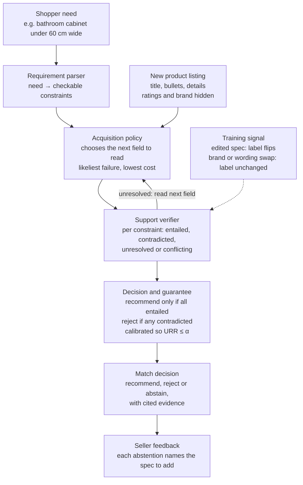
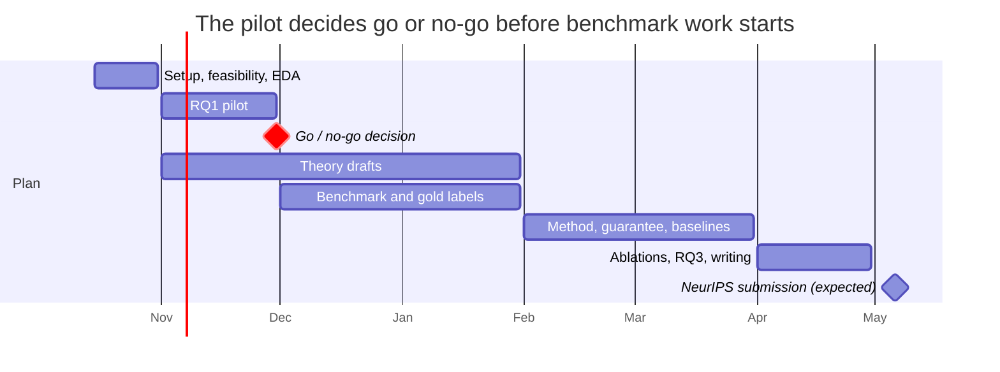

# Before the First Review: Research Proposal

Oct 17, 2026 · yui chan

**How can a new product find the customers it genuinely serves, before it has reviews, popularity, or an established brand?** This project argues that today's AI recommenders answer that question with priors (category, brand, memorized products, persuasive wording) rather than with the evidence in the listing, and builds a matcher that uses evidence only.

**Claim:** for checkable product requirements, AI recommenders match new products on priors rather than evidence. We propose a method that matches only on listing evidence, abstains otherwise, and provably bounds the rate of unsupported matches.

| Item | Decision |
| --- | --- |
| Working title | Before the First Review: Evidence-Grounded Matching of New Products to the Customers They Genuinely Serve |
| Target venue | NeurIPS 2027, main track (deadline expected early May 2027) |
| Dataset | Amazon Reviews 2023: Appliances, Home & Kitchen, Tools & Home Improvement |
| Contributions | (1) a diagnosis of prior licensing in AI recommenders; (2) an evidence-seeking matcher with a finite-sample bound on unsupported recommendations; (3) a benchmark validated against post-launch reviews |

## Problem and motivation

New products start with a structural disadvantage, and AI shopping assistants risk making it worse by trusting priors over evidence.

**New products are invisible to classic recommenders.** Collaborative filters recommend from sales and ratings, so they cannot recommend products with little history, and they can reduce aggregate sales diversity (Fleder & Hosanagar). Reviews strongly drive sales (Chevalier & Mayzlin, 2006), and early reviews matter most for new products (Cui, Lui & Guo, 2012).

**LLM recommenders handle new products, but by priors.** Text-based and generative recommenders (UniSRec, Recformer, TIGER) place a new item near similar known items. That is a prior, not evidence. A cabinet described as "compact" with no width listed may be recommended to a shopper who needs "under 60 cm" because similar cabinets usually fit.

**Priors can be gamed.** Strategic text on a product page can push it to the top of LLM recommendations (Kumar & Lakkaraju, 2024; Nestaas et al., ICLR 2025). Review manipulation already concentrates on young products (He, Hollenbeck & Proserpio, 2022).

**A wrong match hurts the new product itself.** If a 65 cm cabinet is shown to people who need under 60 cm, early buyers return it and leave bad reviews, and the product may never recover. So precision is in the new product's own interest, not just the shopper's.

**Running example.** A new listing reads "Compact Bathroom Storage Cabinet, White", lists height 80 cm and MDF, but no width. The right answer to "white bathroom cabinet under 60 cm wide" is *cannot tell yet: add a width*. A prior-driven model says *yes*.

## Research questions and definitions

Three questions, each depending on the one before: is there a problem, can we fix it, and does the fix matter.

| RQ | Question | Contribution | How it is tested |
| --- | --- | --- | --- |
| RQ1: diagnosis | Do AI recommenders match new products on listing evidence, or on priors, brands and persuasive wording? | Evidence of prior licensing | Evidence ablations and counterfactual edits on the same listing |
| RQ2: method | Can an agent match on evidence alone, abstain when evidence is missing, and guarantee a bounded rate of unsupported matches? | Method, theory and guarantee | Benchmark results against 10 baselines |
| RQ3: outcome | Do evidence-based matches at launch predict which customers were satisfied after launch? | Real-world validation | Predictions at launch vs. later reviews |

**Definitions used throughout**

- **New product:** launched on or after the cutoff (default 1 Jan 2022, set by the feasibility count). Launch date = "Date First Available" in the listing, else the first review date.
- **Before reviews, popularity, brand:** the model sees only the listing (title, bullets, description, `details` specs). Ratings, review counts, store and reviews are hidden.
- **Need profile:** a shopper need written as a conjunction of checkable constraints, e.g. width < 60 cm AND room = bathroom.
- **Genuinely serves:** the listing's evidence supports every constraint, validated against hidden specs and post-launch reviews.
- **Prior licensing:** a decision that would stay the same if the supporting evidence were removed.
- **Unfamiliar product:** bottom third by rating count, recent launch, or small store. Used only to stratify results, never shown to the model.
- **In scope:** dimensions, material, capacity and color. Out of scope: profitability, persuasion, experience attributes such as "sturdy".

## Related work and the gap

Each line of work solves one piece of the question; none checks whether a listing's evidence supports a need, abstains when it doesn't, and verifies the match after launch.

| Area | Key papers | What they do | What they miss |
| --- | --- | --- | --- |
| New items in recommendation | UniSRec (KDD 2022), Recformer (KDD 2023), TIGER (NeurIPS 2023) | Recommend new items from text or semantic IDs | Match by similarity, a prior; no evidence check |
| Customer needs from reviews | Timoshenko & Hauser (Marketing Science 2019) | Reviews reveal needs as well as interviews do | Find needs; do not match new products to them |
| Evidence vs. memory in LLMs | Longpre et al. (EMNLP 2021), Knowledge Conflicts survey (EMNLP 2024), Context-aware Decoding (NAACL 2024) | Show and reduce models' reliance on memory over context | No abstention when evidence is absent; not recommendation |
| Counterfactual faithfulness training | Faithfulness-QA (2026), CANOE (2025) | Train models to follow edited context | Single answers, not conjunctions; no abstention or guarantee |
| Abstention with guarantees | Selective classification (NeurIPS 2017), conformal abstention (2024) | Abstain with a bounded error rate | Bound error, not unsupported decisions |
| Information acquisition | EDDI (ICML 2019), AR-Bench (ICML 2025) | Decide what to look up | Stop on confidence, which priors can satisfy |
| Manipulation of LLM recommenders | Kumar & Lakkaraju (2024), Nestaas et al. (ICLR 2025), GEO (KDD 2024) | Persuasive text shifts recommendations | Attacks only; no defense |
| New-product economics | Fleder & Hosanagar, Chevalier & Mayzlin (2006), He et al. (2022) | New products are disadvantaged; reviews and manipulation shape outcomes | No AI method |
| Amazon Reviews 2023 users | BLaIR (ACL 2026), LLM2Rec (KDD 2025), ETEGRec (SIGIR 2025) | Next-item and generative recommendation | Never use `details` specs or post-launch reviews as ground truth |

**The distinction reviewers must see:** a correct but unsupported recommendation passes an error-rate guarantee and fails ours. Our guarantee is on *support*, not *accuracy*.

## Formal problem

A need is a conjunction of constraints; a recommendation is allowed only when every constraint is entailed by evidence the agent actually inspected.

- **Product** x with listing fields F(x) = {title, bullets, description, details, images}; each field f has an inspection cost c(f).
- **Need** R = {r₁, …, rₖ}. The product matches R only if every rᵢ holds.
- **Support status** of each constraint given inspected evidence E: s(rᵢ, E) ∈ {entailed, contradicted, unresolved, conflicting}.
- **Policy** π inspects fields in sequence, then outputs a decision d ∈ {recommend, reject, abstain}.
- **Decision rule:** recommend only if all s(rᵢ, E) = entailed; reject if any is contradicted; otherwise abstain. Priors may order inspection but never license a recommendation.

The primary metric is the unsupported recommendation rate:

$$
\mathrm{URR}(\pi) = \Pr\big[\, \exists\, i : s(r_i, E_\pi) \neq \text{entailed} \;\big|\; d_\pi = \text{recommend} \,\big]
$$

The objective minimizes expected inspection cost and abstentions on matchable items, subject to the support constraint:

$$
\min_{\pi} \; \mathbb{E}\Big[\textstyle\sum_{f \in E_\pi} c(f)\Big] + \lambda \, \Pr[d_\pi = \text{abstain} \mid \text{match}] \quad \text{s.t.} \quad \mathrm{URR}(\pi) \le \alpha
$$

**Why the conjunction matters:** rejecting needs one contradicted constraint, but recommending needs all of them supported. A single confidence score hides this asymmetry.

## Data and benchmark

All data comes from [Amazon Reviews 2023](https://amazon-reviews-2023.github.io/), which uniquely gives us listing specs, launch timing and post-launch reviews in one public release.

**What the dataset supplies**

| Need | Field | Use |
| --- | --- | --- |
| Listing evidence | `title`, `features`, `description`, `details` | What the model may see |
| Ground-truth specs | `details` (product dimensions, material, capacity, color) | Hidden truth for labels and variants |
| Launch timing | `details` "Date First Available", review timestamps | Defines new products |
| Shopper needs | Review text of established products | Mined need profiles |
| Post-launch truth | Reviews of new products after launch | RQ3 labels |
| Popularity | `rating_number` | Stratification only, hidden from the model |

Categories in order: Appliances (development), Home & Kitchen, Tools & Home Improvement. Join reviews to listings on `parent_asin`; exclude package dimensions, which measure the box.

**Need profiles.** Fit and misfit statements are mined from reviews of products launched before the cutoff ("too wide for my space", "fits under my sink"), converted to constraints with an LLM, clustered, and human-checked on a sample. Synthetic needs are added from the spec distribution with thresholds near true values, so cases are hard.

**Evidence variants**, generated from each complete listing:

| Variant | Change to the listing | Correct behavior |
| --- | --- | --- |
| Complete | None | Decide from evidence |
| Missing | Relevant spec removed | Abstain |
| Vague | Spec replaced by a word like "compact" | Abstain |
| Edited | Value changed, e.g. 55 to 65 cm | Decision flips |
| Conflicting | Title and specs disagree | Abstain or flag conflict |
| Brand or popularity swap | Brand cue changed, evidence identical | Decision unchanged |
| Marketing rewrite | Persuasive, unverifiable claims added | Decision unchanged |

**Three label layers.** Spec labels are automatic from hidden `details` (large; for training and main evaluation). Post-launch labels come from later reviews of new products (RQ3). Gold labels cover 500–1,000 pairs from 2–3 human annotators, with agreement reported.

**Splits.** Train on products launched before the cutoff; test on products launched after it from brands unseen in training; hold out one category for transfer.

**Target sizes**, to be revised after the feasibility count: 20–40K products, 2–5K need profiles, about 300K product–need pairs including variants, 10–30K post-launch test pairs.

**Release and license.** Academic, non-commercial use only. We release product IDs, build scripts, need profiles in our own words and our labels, never raw Amazon text.

## Method

The evidence-seeking matcher reads only as much of the listing as it needs and recommends only when every constraint is supported by what it read.

The policy keeps reading fields while any constraint is unresolved; the decision layer recommends only when all are entailed, and every abstention becomes a listing fix for the seller.

- **Verifier training:** counterfactual evidence pairs from the dataset. An evidence-sensitivity loss penalizes labels that do not flip when a spec is edited; an invariance loss penalizes labels that change under brand, popularity or marketing swaps.
- **Acquisition policy:** reinforcement learning with reward = correct supported decision − λ₁ × unsupported recommendation − λ₂ × inspection cost − λ₃ × unnecessary abstention. Fallback if RL is too costly: a fixed, cost-ordered inspection sequence.
- **Guarantee:** conformal risk control or Learn-then-Test on held-out data sets the threshold so that URR ≤ α.
- **Base model:** an open-weight 7–8B instruction model fine-tuned with LoRA; frontier API models serve as prompted baselines.

## Theory

The theory shows that the two standard tools, calibrated abstention and value-of-information acquisition, cannot prevent unsupported recommendations, and that our decision layer can. Drafts are written Nov 2026–Jan 2027, in parallel with data work.

1. **Separation (calibration is not groundedness).** There exist settings where a perfectly calibrated confidence-threshold policy has URR approaching 1 at any target accuracy: a strong prior plus absent evidence. Proof is constructive.
2. **VOI blindness.** Myopic value-of-information stopping acquires no evidence whenever the prior already exceeds the decision threshold, so acquisition methods inherit the flaw.
3. **Outcome training learns prior licensing.** A model trained only on match outcomes relies on brand, popularity or category cues whenever those correlate with labels in training data; our invariance objective removes that reliance under stated assumptions.
4. **Finite-sample guarantee.** With conformal risk control or Learn-then-Test calibration on n held-out examples, our policy satisfies URR ≤ α with high probability.
5. **Optional: inspection order for conjunctions.** Extend cost-over-failure-probability ordering from sequential testing of series systems to noisy, conflicting evidence, possibly via adaptive submodularity. Attempt only if 1–4 are done by January.

Results 1, 2 and 4 are the minimum the paper needs; 3 strengthens the training contribution.

## Experiments

The RQ1 pilot runs first and decides whether the project goes ahead; everything else depends on it.

**RQ1 pilot (go / no-go, November 2026)**

- About 2,000 Appliances and Home & Kitchen products with parsed dimensions; about 500 width and height requirements.
- Conditions: complete, missing, vague, edited, brand or popularity swap, marketing rewrite.
- Models: one open-weight model and one frontier API model.
- Measures: how often decisions change under each condition, URR, edit-following rate, all split by rating count.
- Memorization probe: give only the title and ask for the specs; high recall means the product was memorized.
- **Go** if decisions often stay the same when evidence is removed or fail to follow edits, especially for popular products. **No-go** if models behave correctly, in which case we reframe before building more.

**RQ2 baselines**

| Baseline | Why it is included |
| --- | --- |
| Prompted frontier LLM, direct and chain-of-thought | Current practice |
| ReAct-style agent with all fields | Agentic current practice |
| Read everything | Upper bound on cost |
| Confidence-threshold abstention | Standard selective prediction |
| Conformal abstention | Error-rate guarantee, the closest guarantee baseline |
| EDDI-style value-of-information acquisition | Standard information acquisition |
| Context-aware decoding | Evidence-following without abstention |
| Counterfactual faithfulness fine-tune | Closest training baseline |
| Recformer and UniSRec | Text-based new-item recommenders |
| LLM fine-tuned on outcomes only | Shows outcome training learns priors |

**Ablations:** remove counterfactual training, the invariance loss, the acquisition policy and the conformal layer, one at a time.

**RQ3 validation:** compare launch-time decisions with fit and misfit statements in later reviews; report precision, coverage, and how many genuinely matching unfamiliar products reach their customers.

**Robustness:** marketing rewrites in the style of generative engine optimization, a held-out category, unseen brands, and optionally Boonthavorn listings collected after model training cutoffs.

**Metrics**

| Metric | Role |
| --- | --- |
| Unsupported recommendation rate (URR) | Primary |
| Accuracy on answered items and coverage | Usefulness; reported as a risk–coverage curve |
| Inspection cost per decision | Efficiency; cost–URR frontier |
| Edit-following and invariance-violation rates | Evidence sensitivity and prior resistance |
| Post-launch precision | RQ3 |
| Recall of matching unfamiliar products, exposure gap | Marketing outcome, secondary |

## Timeline to NeurIPS 2027

The go/no-go decision at the end of November gates everything after it; the submission date is an estimate until the NeurIPS 2027 call is published.

Theory drafts run alongside the benchmark build, so the method phase starts with the guarantee already specified.

## Risks and mitigations

The biggest risk is that the gap does not exist; the pilot tests that within a month.

| Risk | Mitigation |
| --- | --- |
| Models already follow evidence, so there is no gap | Pilot by end of November; reframe early if it fails |
| Too few products have parseable specs | Move to more spec-rich categories; lean more on generated variants |
| Post-launch labels are sparse or noisy | Spec labels are primary; post-launch secondary; human gold set |
| Listings were edited after launch (metadata is a 2023 snapshot) | Use stable spec fields; sensitivity analysis; state the limitation |
| LLMs memorized Amazon products | Memorization probe, counterfactual edits, unseen brands, optional post-cutoff data |
| Reinforcement learning is too costly | Fixed cost-ordered inspection; the guarantee still holds |
| The verifier is itself an LLM | Validate against human gold labels and report its error |
| Compute and API cost | Cache responses; small pilots first; LoRA on a 7–8B model |

**Cut order if behind schedule:** market simulation, then images, then Boonthavorn, then ESCI queries, then the RL policy (use the fallback), then optional theorem 5.

## Expected contributions and later papers

This paper contributes the AI method; two later papers test the business side with real customers.

- **This paper (NeurIPS 2027):** a named failure mode, prior licensing; an evidence-seeking matcher trained to follow evidence and resist priors and persuasion; a finite-sample bound on unsupported recommendations; a benchmark validated against post-launch reviews; and seller feedback that turns each abstention into a specific listing fix.
- **Paper 2 (Marketing Science or Management Science):** which unmet needs found by AI in reviews survive validation by real purchases.
- **Paper 3 (JMR or Management Science):** when evidence and persuasion conflict, which wins repeat customers, tested in a field experiment with a seller partner such as Boonthavorn.

The dissertation umbrella ties them together: *which customers have an unmet need we can profitably solve, and what will persuade them to buy?* AI proposes hypotheses; real customers confirm them.

## Sources

- Dataset: [Amazon Reviews 2023](https://amazon-reviews-2023.github.io/); Hou et al., [BLaIR](https://arxiv.org/abs/2403.03952) (ACL 2026)
- Full literature tables with venues, citation counts and findings: [Papers Using Amazon Reviews 2023](https://claude.ai/code/artifact/242116f9-42d7-444c-95f6-14091ef2359f)
- New items: [Recformer](https://arxiv.org/abs/2305.13731), [TIGER](https://arxiv.org/abs/2305.05065), [LLM2Rec](https://arxiv.org/html/2506.21579v1)
- Needs from reviews: [Timoshenko & Hauser](https://www.informs.org/News-Room/INFORMS-Releases/News-Releases/Can-machine-learning-deliver-critical-market-insights-on-consumer-needs-faster-and-cheaper)
- Evidence vs. memory: [Knowledge Conflicts survey](https://arxiv.org/abs/2403.08319), [Context-aware Decoding](https://aclanthology.org/2024.naacl-short.69)
- Abstention: [Conformal Abstention](https://arxiv.org/abs/2405.01563)
- Acquisition: [EDDI](https://proceedings.mlr.press/v97/ma19c.html), [AR-Bench](https://mlanthology.org/icml/2025/zhou2025icml-passive)
- Manipulation: [Kumar & Lakkaraju](https://arxiv.org/abs/2404.07981), [Nestaas et al.](https://iclr.cc/virtual/2025/poster/28746)
- Economics of new products: [Fleder & Hosanagar](https://repository.upenn.edu/oid_papers/152), [He, Hollenbeck & Proserpio](https://papers.ssrn.com/abstract=3664992), [Cui, Lui & Guo](https://scholars.ln.edu.hk/en/publications/the-effect-of-online-consumer-reviews-on-new-product-sales/)
- Motivation on this dataset: [Cold-Start Retrieval Bottlenecks](https://arxiv.org/html/2606.29947v1)
